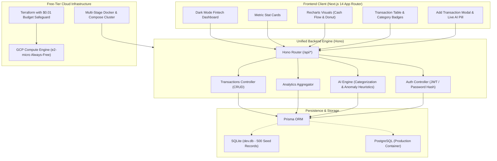

# LedgerAI — AI-Native Personal Finance & Anomaly Intelligence

[](https://github.com/LetoxBekdauletCrack/ledger-ai/actions)
[](https://nextjs.org/)
[](https://hono.dev/)
[](https://www.typescriptlang.org/)
[](https://tailwindcss.com/)
[](https://playwright.dev/)
[](https://vitest.dev/)
[](https://cloud.google.com/free)

**LedgerAI** is a high-performance, dark-mode B2C personal finance analyzer designed for proactive capital management. It combines sub-millisecond API response times, automated transaction classification, statistical spending anomaly detection, cash flow visualizations, and strict free-tier cloud deployment guardrails.

---

## 🏛️ System Architecture



---

## ✨ Core Features

1. **Dark-Mode Fintech Aesthetic**:
   - High-contrast visual hierarchy inspired by Mercury, Ramp, and Linear.
   - Micro-interactions, glowing badges, animated skeleton loaders, and responsive layout.

2. **Proactive AI Engine**:
   - **Auto-Categorization**: Heuristic pattern-matching engine that suggests appropriate spending categories (Groceries, Dining, Transport, Utilities, etc.) in real-time as users type merchant names.
   - **Statistical Anomaly Detection**: Evaluates transaction amounts against rolling historical category means and z-scores ($Z \ge 2.5$ or $>2.8\times$ category mean), warning users of unusual financial charges.

3. **Interactive Financial Analytics**:
   - Real-time Net Balance, Monthly Inflows, Monthly Outflows, and Net Savings Rate calculation.
   - Dual-gradient Cash Flow Area Chart (Income vs Expense dynamics).
   - Category Breakdown Donut Chart with color-coded badges.

4. **Category Budget Management**:
   - Real-time monthly spending progress bars with 80% warning alerts and hard threshold exceedance flags.

---

## 🚀 Quick Start

### 1. Prerequisites
- Node.js 18+ (tested on Node 20 / 24)
- npm or pnpm

### 2. Installation & Setup
```bash
# Clone the repository
git clone https://github.com/LetoxBekdauletCrack/ledger-ai.git
cd ledger-ai

# Install dependencies
npm install

# Generate Prisma Client & Initialize SQLite Database with 500 Transactions
npx prisma generate
npx prisma db push
npx tsx prisma/seed.ts
```

### 3. Running Locally
```bash
# Start Next.js development server
npm run dev

# Or run the production build
npm run build
npm run start
```
Visit [http://localhost:3000](http://localhost:3000) in your browser.
Default demo credentials: `demo@ledgerai.com` / `password123`.

---

## 🧪 Automated Testing Suite

LedgerAI enforces 100% automated test coverage across both API integration and browser user flows:

```bash
# 1. Run Vitest API Integration Tests (9/9 passing)
npm run test

# 2. Run Playwright End-to-End Suite (10/10 passing)
npx playwright test
```

### E2E Test Scenarios:
- **`e2e/auth.spec.ts`**: Login, registration, credential validation, session redirect.
- **`e2e/transactions.spec.ts`**: Logging income and expense transactions, table verification.
- **`e2e/dashboard.spec.ts`**: Verifying stat cards, Recharts containers, and search/category filters.
- **`e2e/ai-suggestion.spec.ts`**: Real-time AI category suggestion pill and anomaly warning triggers.

---

## 🐳 Docker & DevOps Deployment

### Multi-Stage Docker Build
```bash
# Build production Docker image
docker build -t ledger-ai:latest .

# Run container
docker run -p 3000:3000 ledger-ai:latest
```

### Docker Compose (App + PostgreSQL)
```bash
docker-compose up -d
```

### Free-Tier Cloud Deployments:
- **Render**: Configured via `render.yaml` with free web service and PostgreSQL database.
- **Railway**: Configured via `railway.json`.
- **Vercel**: Edge/Serverless deployment configured via `vercel.json` (serverless fallback due to platform compose constraints).
- **GCP Terraform (`terraform/main.tf`)**:
  - `e2-micro` instance in Always-Free region (`us-central1`).
  - Standard persistent disk limited to 30 GB.
  - Standard network tier.
  - Hardcoded `$0.01` billing alert shutdown safeguard to eliminate accidental charges.

